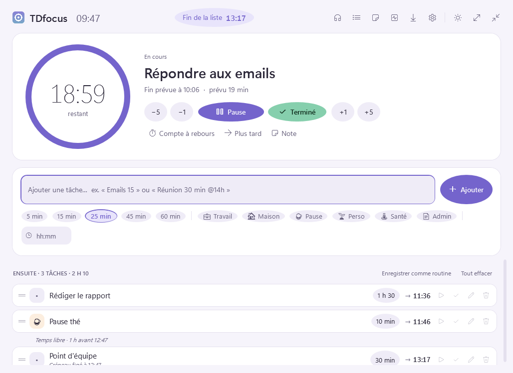
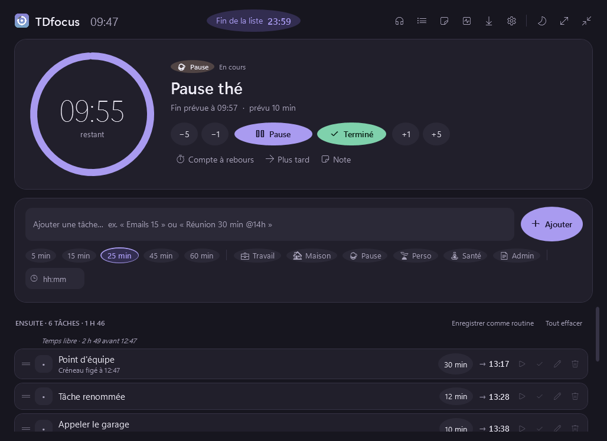
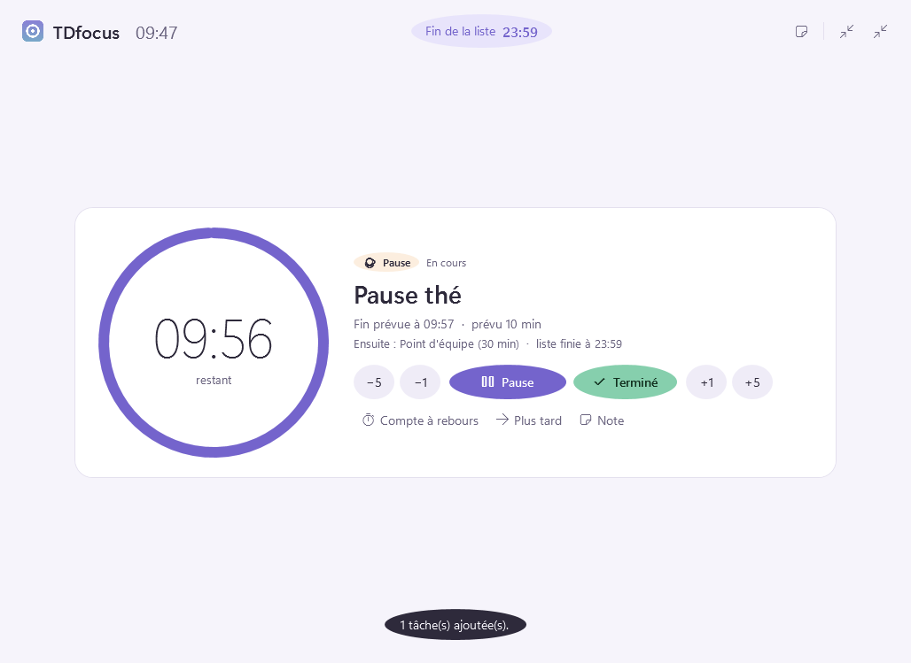
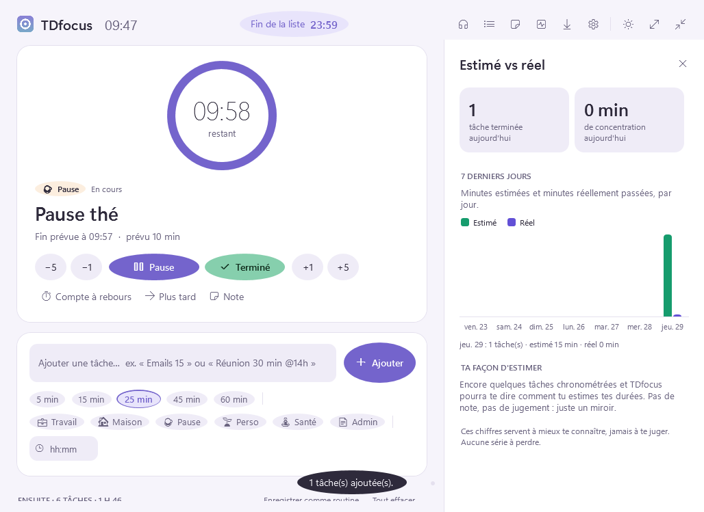
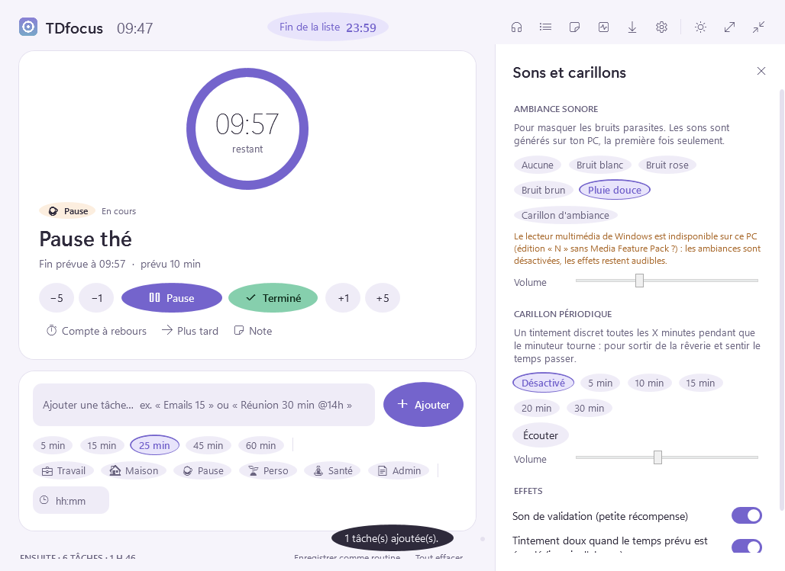
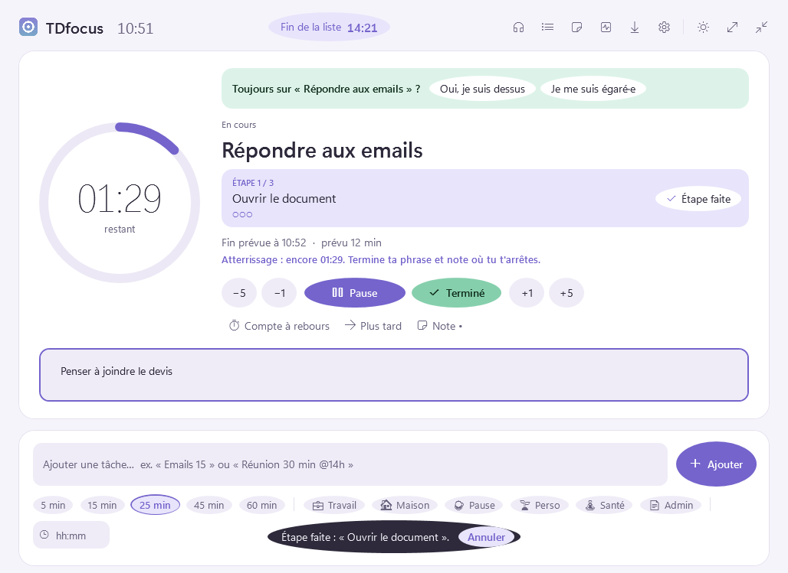
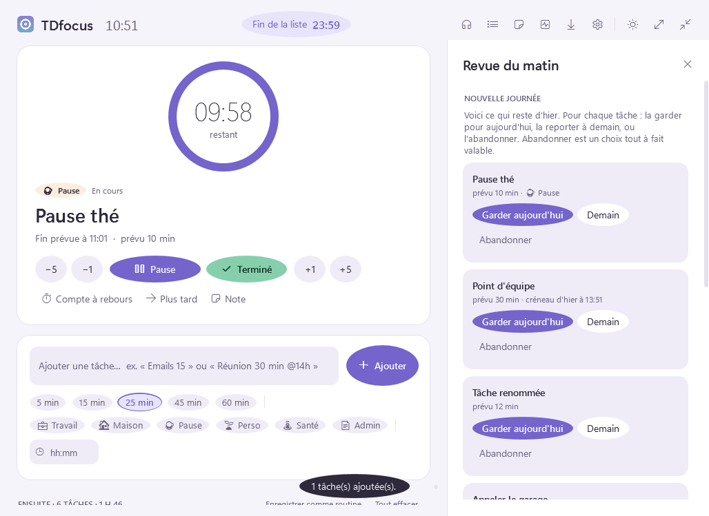
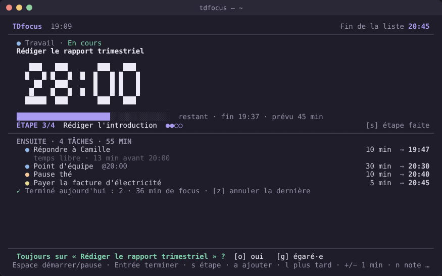

# TDfocus

**Une seule tâche à la fois, et l'heure de fin toujours sous les yeux.**

TDfocus transforme une to-do list statique en **ligne de temps séquentielle**. On ne voit
qu'une tâche, un grand minuteur et l'heure à laquelle on aura fini, tâche par tâche et pour
toute la liste. L'application est pensée pour les adultes et étudiants avec un TDAH, et plus
largement pour toute personne sujette à la cécité temporelle, à la dispersion ou à la
paralysie de la décision.

- Application de bureau **Windows**, écrite en **PowerShell** (interface WPF), et
  **version Linux** en plein terminal (PowerShell 7), avec le même cœur et les mêmes
  fonctionnalités.
- **Aucun droit administrateur ni root** requis, ni pour l'installation ni pour l'utilisation.
- **Se lance toute seule** à l'ouverture de session (option désactivable), sans le moindre
  flash de console sous Windows.
- **100 % locale et hors ligne** : pas de compte, pas de serveur, pas de télémétrie.



| Thème sombre | Mode focus |
|---|---|
|  |  |
| **Estimé vs réel** | **Sons et carillons** |
|  |  |

Mode compact flottant, toujours au premier plan :


*Captures réalisées automatiquement par l'intégration continue, sous Windows PowerShell 5.1.*

---

## Installation sous Windows (sans droits administrateur)

1. Télécharger le dépôt (bouton **Code ▸ Download ZIP**) puis l'extraire.
2. Double-cliquer sur **`Install.cmd`**.

L'installateur :

| Action | Emplacement (profil de l'utilisateur uniquement) |
|---|---|
| Copie de l'application | `%LOCALAPPDATA%\Programs\TDfocus` |
| Lanceur sans console | `TDfocus.exe`, compilé sur place par le compilateur C# fourni avec Windows |
| Raccourcis | menu Démarrer et Bureau (option `-NoDesktopShortcut`) |
| Lancement automatique | `HKCU\Software\Microsoft\Windows\CurrentVersion\Run` |
| Données (liste, historique, notes) | `%APPDATA%\TDfocus` |

Il retire aussi la « marque du Web » des fichiers téléchargés, puis lance TDfocus.
PowerShell est exécuté avec `-ExecutionPolicy Bypass` **pour ce seul processus**, sans
modifier la stratégie d'exécution de l'ordinateur.

Le petit lanceur `TDfocus.exe` démarre PowerShell sans fenêtre : **aucune console ne
clignote** à l'ouverture de session ni au clic sur un raccourci. Si sa compilation est
bloquée (stratégie d'entreprise), l'installateur revient à un lancement direct de
PowerShell.

- **Lancer sans installer** : `TDfocus.cmd`.
- **Désinstaller** : `Uninstall.cmd` (ajouter `-RemoveData` pour effacer aussi les données).
- **Prérequis** : Windows 10 ou 11 avec Windows PowerShell 5.1, déjà inclus. Rien à
  télécharger. PowerShell 7 fonctionne aussi.

> Le lancement automatique se règle dans **Réglages ▸ Démarrage de Windows**. TDfocus peut
> s'ouvrir normalement (pour planifier la journée) ou rester discret dans la zone de
> notification. Un choix fait dans *Paramètres Windows ▸ Applications ▸ Démarrage* est
> toujours respecté.

## Installation sous Linux (sans root)

```sh
sh install-linux.sh
```

| Action | Emplacement (dossier personnel uniquement) |
|---|---|
| Copie de l'application | `~/.local/share/TDfocus/app` |
| Commande `tdfocus` | `~/.local/bin/tdfocus` |
| Menu des applications | `~/.local/share/applications/tdfocus.desktop` |
| Lancement automatique | `~/.config/autostart/tdfocus.desktop` (GNOME, KDE, Xfce, Cinnamon, MATE…) |
| Données (liste, historique, notes) | `~/.config/TDfocus` |

- **PowerShell 7** est utilisé s'il est installé. Sinon, une version portable est téléchargée
  dans `~/.local/share/TDfocus/pwsh`, toujours sans root (x64, ARM64, ARM32, musl).
- À l'ouverture de session, TDfocus s'ouvre dans ton émulateur de terminal (variable
  `TERMINAL`, sinon `x-terminal-emulator`, GNOME Terminal, Konsole, Xfce, kitty, Alacritty,
  foot, WezTerm, xterm…).
- **Sons** : joués par `pw-play`, `paplay` ou `aplay` (PipeWire, PulseAudio ou ALSA).
- **Notifications** : `notify-send`, si présent.
- **Lancer sans installer** : `pwsh src/TDfocus.Terminal.ps1`.
- **Désinstaller** : `sh uninstall-linux.sh` (ajouter `--purge` pour effacer aussi les données).
- Options de l'installateur : `-NoAutostart`, `-NoLaunch`.

---

## Utilisation

### Ajouter des tâches : un seul champ

Il suffit d'écrire, puis de valider avec Entrée :

| Saisie | Résultat |
|---|---|
| `Répondre aux emails 15` | 15 min |
| `Rédiger le rapport 1h30` | 1 h 30 |
| `Lire 25min` | 25 min |
| `Point d'équipe 30 @14h` | 30 min, **créneau figé** à 14:00 |
| `Dentiste à 9h30 45m` | 45 min, créneau figé à 09:30 |

Sous le champ se trouvent les **pastilles de durée** (5, 15, 25, 45, 60 min), les
**catégories** (émoji et couleur douce, sans sous-dossiers) et un champ **heure fixe**.
Quand l'historique est suffisant, TDfocus propose une durée ajustée, par exemple :
*« d'après ton historique, cela prend plutôt ~32 min (×1,3) »*.

### Le moteur séquentiel

- **Carte focus** : la tâche en cours, un grand minuteur circulaire et son heure de fin.
  Le reste de la liste passe en retrait.
- **Compte à rebours** ou **compte progressif**, au choix, si le décompte crée de l'anxiété.
- **+1 / +5 / −1 / −5 min** à la volée, sans casser la session.
- **Validation manuelle** (renforcement positif) : son léger, micro-confettis, message de
  félicitation **avec annulation**.
- **Dépassement** : le minuteur passe en *temps additionnel* (ambre doux, jamais de rouge).
  Pas d'alarme punitive : un tintement doux, une seule fois, désactivable.
- **Plus tard** : reporte la tâche en fin de liste, sans culpabiliser.
- **Glisser-déposer** pour réordonner. Déposer une tâche sur la carte la rend active. Le
  menu contextuel (clic droit) permet aussi de monter, descendre, commencer maintenant, etc.
- **Mode focus** (F) : uniquement la tâche, le minuteur et la suivante.
- **Mode compact** (M) : petite barre flottante, au premier plan, dans un coin de l'écran.

### Ancrage temporel

- **Heure de fin de la liste** en haut de la fenêtre, recalculée en continu à partir de
  l'heure réelle.
- **Heure de fin projetée** sur chaque tâche de la file.
- **Décalage visible** : dès qu'une tâche déborde ou qu'une pause s'allonge, un badge
  `+6 min` indique l'effet sur la fin de journée (ou `−4 min` en avance).
- **Créneaux figés** : une réunion à 14:00 ne commence pas avant 14:00. Le temps libre
  avant elle est affiché, et un éventuel retard est signalé avec douceur.
- Le temps restant figure aussi dans le **titre de la fenêtre** et l'**info-bulle de la zone
  de notification**.

### Pour rester sur les rails



- **Sous-étapes** : une tâche peut être découpée en petites étapes (une par ligne dans
  l'éditeur). Seule l'étape en cours est affichée sur la carte, avec sa progression
  (`ÉTAPE 2/4 ●●○○`). Bouton **Étape faite** ou touche **S**, annulation possible. Les routines
  intégrées en contiennent déjà (« Préparer mes affaires », « Choisir les 3 priorités de
  demain »…).
- **Signal d'atterrissage** : 1, 2 ou 5 minutes avant la fin prévue, un son doux et un
  message (« Termine ta phrase et note où tu t'arrêtes ») préparent la transition, au lieu
  d'une coupure brutale.
- **Compteur de pause visible** : « En pause depuis 12 min » sur la carte, dans le titre de
  la fenêtre, l'info-bulle et le mode compact. Une pause qui s'éternise se voit.
- **Point de contrôle au carillon** : à chaque carillon périodique, une question discrète,
  « Toujours sur ta tâche ? ». *Oui* ou *je me suis égaré·e* : ce second choix propose de
  noter la distraction et rappelle l'étape en cours. Sans réponse, la question s'efface au
  bout de 90 s. Le résumé apparaît dans les statistiques, sans jugement.
- **Revue du matin** : au premier lancement d'une nouvelle journée, les tâches restées
  d'hier sont présentées une par une : **garder aujourd'hui**, **reporter à demain** (elle
  reviendra seule le lendemain) ou **abandonner**, qui est un choix tout à fait valable.



### Stimulations sensorielles (🎧)

- **Ambiances** : bruit blanc, rose ou brun, pluie douce, carillon d'ambiance. Elles sont
  générées en PowerShell sur le PC, la première fois seulement, puis bouclent sans coupure
  (fondu croisé).
- **Carillon périodique** toutes les 5, 10, 15, 20 ou 30 minutes pendant que le minuteur
  tourne, pour sortir de la rêverie.
- **Son de validation** léger et gratifiant.

### Le reste, en surface (zéro menu imbriqué)

| Bouton | Contenu |
|---|---|
| 📋 Routines | Routine du matin, sprint de deep work, closing de fin de journée, ou toute liste enregistrée en un clic |
| 📝 Bloc-notes | « Parking à idées » : noter une pensée parasite sans quitter la tâche, puis en faire une tâche plus tard. Chaque tâche a aussi sa propre note |
| 📊 Estimé vs réel | Graphique des 7 derniers jours, facteur d'estimation médian, détail par catégorie. Aucun score négatif, aucune série à perdre |
| ⇩ Importer | Google Agenda / Outlook (adresse iCal secrète ou fichier `.ics`), Todoist (jeton d'API), Notion (intégration), texte collé (listes Markdown, copier-coller Notion…) |
| ⚙ Réglages | Thème (comme Windows / clair / sombre), minuteur, démarrage, catégories, sauvegarde et restauration |

### Raccourcis clavier

| Touche | Action |
|---|---|
| Espace | Démarrer / pause |
| Ctrl + Entrée | Valider la tâche en cours |
| S | Étape faite |
| + / − | Ajouter / retirer 1 minute |
| L | Reporter la tâche en fin de liste |
| N ou Ctrl + N | Nouvelle tâche |
| F / M | Mode focus / mode compact |
| Échap | Fermer le panneau, revenir à la vue complète |

---

## Version Linux (terminal)



La version Linux reprend tout, au clavier : minuteur en gros chiffres (compte à rebours ou
progressif), heure de fin de la liste et décalage, file avec heures projetées et créneaux
figés, sous-étapes, atterrissage, compteur de pause, points de contrôle, revue du matin,
ambiances sonores, routines, bloc-notes, statistiques et réglages. Les couleurs
s'adaptent (24 bits, `NO_COLOR` respecté) et l'écran se réorganise selon la taille du
terminal.

| Touche | Action |
|---|---|
| Espace / Entrée | Démarrer ou mettre en pause / valider la tâche en cours |
| s / S | Étape faite / revenir à l'étape précédente |
| a | Ajouter une tâche (même saisie rapide : `Rapport 1h30`, `Réunion 30 @14h`) |
| e / p | Modifier la tâche choisie / ses sous-étapes (séparées par `;`) |
| + / − et ] / [ | ±1 min et ±5 min |
| l | Plus tard (fin de liste) |
| ↑ / ↓, K / J | Choisir une tâche, la monter / descendre |
| d / v / x | Commencer maintenant / marquer faite / supprimer la tâche choisie |
| z | Annuler la dernière action |
| o / g | Pendant un point de contrôle : oui / je me suis égaré·e |
| n / N | Note rapide / bloc-notes |
| r / t / o / ? | Routines / statistiques / réglages / aide |
| q | Quitter (le minuteur continue de compter) |

---

## Correspondance avec le cahier des charges

| Fonctionnalité | Phase | Statut |
|---|---|---|
| Liste séquentielle titre + durée, glisser-déposer | MVP | ✅ |
| Minuteur central, une seule tâche affichée | MVP | ✅ |
| Heure d'achèvement de la liste en temps réel | MVP | ✅ |
| Bruit blanc / rose et son de validation | MVP | ✅ (plus bruit brun, pluie, carillon) |
| Mode clair / sombre | MVP | ✅ (et suivi du thème de Windows) |
| Presets de durée, catégories couleur/émoji | MVP | ✅ |
| Compte progressif, ±1/±5 min, temps additionnel sans alarme | MVP | ✅ |
| Heure de fin par tâche, détection du retard | MVP | ✅ |
| Templates de routines enregistrables | Phase 2 | ✅ |
| Carillons périodiques configurables | Phase 2 | ✅ |
| Intégration calendrier : créneaux figés vs tâches flottantes | Phase 2 | ✅ (iCal, `.ics`) |
| Statistiques estimé vs réel | Phase 2 | ✅ (avec suggestions de durée) |
| Import Notion / Todoist / Google Agenda (unidirectionnel) | Phase 2 | ✅ |
| Prise de notes | Phase 3 | ✅ (parking à idées + note par tâche) |
| Sous-étapes, signal d'atterrissage, compteur de pause | Ajout | ✅ |
| Point de contrôle au carillon, revue du matin | Ajout | ✅ |
| Version Linux | Ajout | ✅ (terminal, PowerShell 7) |

### Adaptation des spécifications techniques

Le cahier des charges proposait une PWA. Conformément à la demande (application écrite en
PowerShell, lancée au démarrage, sans droits administrateur), voici les équivalents retenus :

| Spécification | Réalisation dans TDfocus |
|---|---|
| Client web (PWA) | Application de bureau WPF pilotée par PowerShell 5.1 / 7 |
| Offline-first, IndexedDB / SQLite | Fichiers JSON locaux écrits de façon atomique, avec copie de secours `.bak` |
| Décompte maintenu onglet fermé (Web Workers) | Temps stocké en horodatages : le décompte reste juste même application fermée ou PC en veille. Si le PC a été éteint longtemps, le minuteur est mis en pause à l'heure de fermeture |
| API Web Audio | Synthèse des sons en PowerShell pur (WAV mis en cache), lecture `MediaPlayer` avec fondu croisé |
| Imports Notion / Todoist / Google Calendar | API Notion et Todoist, adresse iCal de Google Agenda ou Outlook, fichiers `.ics`, texte collé. Les jetons sont chiffrés avec DPAPI |
| Multiplateforme | Windows (WPF) et Linux (terminal) partagent le même cœur logique et le même format de données |
| Applications mobiles natives | Hors périmètre de cette version. Le cœur logique (`src/Core`) ne dépend d'aucune interface et peut être réutilisé |

---

## Architecture

```
Install.cmd / Install-TDfocus.ps1      Windows : installation utilisateur (sans admin)
Uninstall.cmd / Uninstall-TDfocus.ps1  Windows : désinstallation
TDfocus.cmd                            Windows : lancement sans installation
install-linux.sh                       Linux : installation (sans root), PowerShell 7 portable si besoin
Install-TDfocus.Linux.ps1              Linux : copie, commande tdfocus, menu, démarrage automatique
uninstall-linux.sh                     Linux : désinstallation
src/
  TDfocus.ps1          Windows : point d'entrée (instance unique, minuteur, boucle WPF)
  TDfocus.Terminal.ps1 Linux : point d'entrée (terminal, instance unique, relance dans un terminal)
  TDfocus.Core.ps1     chargeur du cœur logique (partagé avec les tests)
  Core/                logique pure, testée : tâches et sous-étapes, projection horaire, saisie
                       rapide, routines, statistiques, imports (iCal, Todoist, Notion, texte),
                       notes, signaux (atterrissage, fin, carillon), points de contrôle, revue
  Storage.ps1          persistance JSON atomique, sauvegardes, chiffrement des jetons
  Audio/               synthèse sonore (PowerShell pur) et lecture
  Platform/            Windows (clé Run, lanceur TDfocus.exe, imports réseau) et Linux (XDG,
                       émulateurs de terminal, notifications)
  UI/                  Windows : fenêtre XAML, thèmes, vue principale, liste, panneaux
  Terminal/            Linux : texte et couleurs, écrans, clavier et minuteur, sons
assets/                icône
tests/                 tests Pester (cœur, fonctionnalités, imports, terminal, dépôt) et test d'interface
tools/                 test de la version Linux dans un vrai pseudo-terminal
```

Principe central : la tâche en cours est toujours la première de la file, et le temps
passé est stocké sous forme d'horodatages (`elapsedMs` + `runningSince`). Tout ce qui est
affiché (minuteur, heures de fin, décalage) est recalculé à partir de l'heure réelle.

## Tests

```powershell
Install-Module Pester -MinimumVersion 5.5 -Scope CurrentUser
Invoke-Pester -Path tests
```

- `tests/Core.Tests.ps1` : moteur séquentiel, projection horaire, statistiques, stockage.
- `tests/Features.Tests.ps1` : sous-étapes, compteur de pause, signaux, points de contrôle,
  revue du matin.
- `tests/Terminal.Tests.ps1` : version Linux (largeur des caractères, écrans à toutes les
  tailles, clavier, minuteur, intégration XDG).
- `tools/test_tui_pty.py` : lance la version Linux dans un vrai pseudo-terminal, la pilote au
  clavier et vérifie l'écran et les données (`python3 tools/test_tui_pty.py`).
- `tests/Import.Tests.ps1` : iCalendar (fuseaux, récurrences, exceptions), Todoist, Notion, texte.
- `tests/Repository.Tests.ps1` : encodage UTF-8 avec BOM (indispensable à PowerShell 5.1),
  syntaxe, éléments XAML et fonctions référencés.
- `tests/Gui.Smoke.ps1` : scénario d'interface complet sous Windows
  (`src\TDfocus.ps1 -SmokeTest -Screenshot <dossier>`), exécuté par l'intégration continue
  avec Windows PowerShell 5.1 et PowerShell 7 (captures d'écran en artefact).
- L'intégration continue installe aussi TDfocus dans le profil utilisateur. Sous Windows,
  elle vérifie la clé de démarrage automatique et le raccourci, lance la commande exacte
  inscrite au démarrage en contrôlant qu'aucune console n'apparaît, puis désinstalle et
  contrôle qu'il ne reste rien. Sous Linux, elle installe sans root, vérifie le menu, le
  démarrage automatique et l'ouverture dans un terminal, puis désinstalle.

## Limites connues

- Sous Linux, l'interface est en mode texte (pas de fenêtre graphique). L'ouverture
  automatique demande une session graphique et un émulateur de terminal. macOS n'est pas
  pris en charge officiellement.
- Sous Linux, une boucle d'ambiance peut continuer jusqu'à une minute si le terminal est
  fermé brutalement.
- Si une stratégie de groupe impose `AllSigned`, les scripts doivent être signés par
  l'organisation.
- Sur les éditions Windows « N » sans Media Feature Pack, les ambiances sonores sont
  désactivées. Les effets restent audibles grâce à un lecteur de repli.
- L'import est unidirectionnel (rien n'est renvoyé vers Notion, Todoist ou l'agenda).
